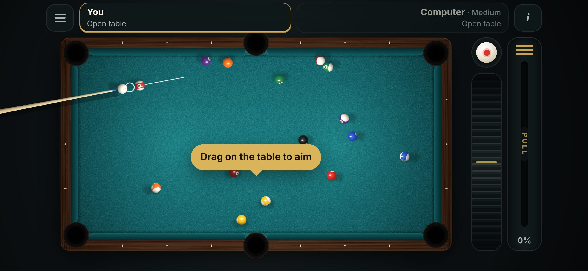

# Baize

8-ball pool for iPhone, built as a home-screen web app. Played in landscape.

- Play pass-and-play on one phone, or against the computer at three levels. There's also a free practice table.
- Physics are deterministic, rules are WPA-based, and it works offline.
- No accounts, ads, coins or servers.

**Live:** https://strikeadeal.github.io/Pool/



## Install it on your iPhone

1. Open https://strikeadeal.github.io/Pool/ in **Safari**.
2. Tap the Share button, then **Add to Home Screen**, then **Add**.
3. Launch Baize from its icon, holding the phone sideways. It runs full-screen.
   - Holding the phone upright shows a "turn your phone sideways" screen and pauses the game, including a shot in progress. It carries on when you turn back.
   - If the screen doesn't turn, Portrait Orientation Lock is on: switch it off in Control Centre. iOS doesn't let a web app override it.
4. Open it once while online. After that it works in Airplane Mode.

**Updates:**
- After a push to `main`, the installed app downloads the new version in the background the next time it's opened.
- It switches over only when nothing on screen can be tapped: at launch, before the menu appears, or when you next arrive at the menu (the screen goes to the launch colour for a moment while it reloads). It never switches in the middle of a game, and a reload never lands on a button you're about to tap.
- A small "Updated" note confirms it. There's no need to delete and re-add the app.

**Saved games:**
- The game saves after every shot and the moment a shot is taken, so it survives a call, locking the phone, or iOS closing the app mid-shot.
- Safari tabs and the installed app keep **separate** saved games and stats (an iOS rule, not something an app can change).

## The screen

| Where | What |
|---|---|
| Top left | Menu: resume, restart (tap twice), how to play, settings, save and quit, concede (re-rack in practice) |
| Top middle | The two players. The one to shoot has a gold border. Each has seven ball slots: empty until groups are set, then their balls, with a slot emptying as each is potted. The 8 appears when a player is on it. |
| Between the players | The 8-ball button. It shows **Break** or **Open** until groups are set; tap it for a summary of the table. |
| Top right | Spin: the cue ball shows where the cue will hit. |
| Left edge | Power bar, with a cue inside that slides down as you pull. |
| Right edge | Fine-aim roller. With assisted aiming on, a button panel replaces it. |
| Bottom of the table | Turn messages, fouls and results. |

**Left-handed controls** swap the two edges: roller on the left, power on the right.

## How to play

| | |
|---|---|
| **Aim** | Drag anywhere on the table; the cue turns with your finger. Tap a spot to point straight at it. |
| **Fine-tune** | Slide the ribbed roller up or down for small adjustments. |
| **Shoot** | Pull the power bar down and let go. Slide back to the top to cancel. |
| **Spin** | Tap the cue ball in the top-right corner and drag the red dot: above centre for follow, below for draw, sides for english. Spin resets after every shot. |
| **Ball in hand** | Drag the cue ball (it has a ring around it) to place it. |
| **Calling the 8** | The game suggests a pocket (gold ring); tap another pocket to change it. Choose **8-ball pocket: Any pocket** when you set up a game to play without calling. |
| **Watching** | Tap during a shot to fast-forward. |

Rules (WPA 8-ball, details and deviations in [DECISIONS.md](DECISIONS.md#2-rules)):

- **The break:** break from behind the line. Pot a ball, or send four to a cushion, or it's an illegal break.
- **Groups:** the table is open after the break. The first ball you pot legally makes that group (solids or stripes) yours.
- **A legal shot:** hit your own group first, then pot a ball or make any ball touch a cushion. Potting one of yours keeps you at the table.
- **Fouls:** a foul gives your opponent ball in hand anywhere.
- **The 8:** clear your group, then pot the 8 in the called pocket. Potting it early, in the wrong pocket, or on a foul loses. With **Any pocket** chosen at setup, any pocket wins; early or on a foul still loses.

The title screen also has **How to play** and **Stats** (games and wins against each computer level, pot rate, best run and fouls, kept on the phone).

**Settings:**
- Sound and haptics on or off.
- Aim guide: Minimal, Standard or Long.
- Left-handed controls.
- Reduce motion.
- Instant shots.
- Assisted aiming: pick a ball and pocket from a list, with buttons instead of dragging.

## Deployment

Every push to `main` runs the tests, builds and deploys to GitHub Pages (`.github/workflows/deploy.yml`). Pull requests run the tests only. To redeploy without a change, use Actions → **Test and deploy** → **Run workflow**.

One-time settings, already done:
- Settings → Pages → Build and deployment → **Source: GitHub Actions**.
- Settings → Environments → `github-pages`: `main` is allowed to deploy. Without it the deploy job fails with no logs.

**The URL is case-sensitive.** The repository is `Pool`, so the site is `/Pool/`. The installed app and its saved games are tied to the exact URL it was installed from, so renaming the repository later means reinstalling.

## Run it locally

Needs Node 20 or later. There are no dependencies to install.

```sh
npm test          # 45 tests: physics, rules, storage, complete computer-vs-computer games
npm start         # builds to dist/ and serves it at http://localhost:8080/pool/ (like GitHub Pages)
```

- **Testing on your phone:** run `npm start`, then open `http://<your-computer's-LAN-IP>:8080/pool/` on the phone, on the same Wi-Fi.
  - Service workers need HTTPS on anything except localhost, so offline mode and updates only work on the deployed site.
- **Browser tests** (optional; needs Playwright, `npm i -D playwright && npx playwright install chromium webkit`):

  ```sh
  node tools/e2e/verify.cjs chromium --shots   # 31 checks; screenshots into docs/screenshots
  node tools/e2e/verify.cjs webkit             # the same checks in WebKit (29: the two frame-cost checks are Chromium-only)
  node tools/e2e/latency.cjs webkit --throttle # main-thread blocking and tap response at every screen change, ~4x slower CPU (Linux)
  ```

- **Icons and launch images:** to regenerate them from `src/icons/icon.svg`, run `node tools/icons.mjs` (also needs Playwright).

## How it's built

| Path | What it is |
|---|---|
| `src/` | The whole app, served as-is: `index.html`, `css/`, `js/` (ES modules, no framework), icons, `manifest.webmanifest`, `sw.js` |
| `src/js/physics.js` | Deterministic simulation: exact contact times, soft-contact break, cushions and real pocket geometry |
| `src/js/rules.js` | 8-ball rules as pure functions |
| `src/js/ai.js` | Computer opponent |
| `src/js/render.js` | WebGL renderer (balls are shaded per pixel, with rolling number decals) |
| `src/js/textures.js` | Table, rails and pockets, painted once per screen size, off the main thread by `src/js/paint.js` (a worker) |
| `src/js/layout.js` | Viewport measurement (with the iOS workarounds) and where every control goes |
| `src/js/input.js` | Touch controls: aim, power, roller, spin, ball in hand |
| `src/js/feel.js` | **Every control feel value, in one commented file** |
| `src/js/feedback.js` | Sound (recorded hits and rolling, synthesised fallback) and haptics |
| `src/fonts/` | Sofia Sans and Sofia Sans Extra Condensed (latin subsets, SIL Open Font Licence in `OFL.txt`), bundled so the look works offline |
| `src/sounds/` | 14 short WAV clips cut from CC0 recordings by `tools/sounds.mjs` (see Sound credits) |
| `src/js/main.js` | Screens, turns, playback, saving, updates |
| `tools/build.mjs` | Copies `src/` to `dist/` and stamps a version derived from the content into the app and the service worker's precache list (SHA-256, with SRI) |
| `.github/workflows/deploy.yml` | Test → build → deploy to Pages on push to `main`; tests only on pull requests |

**Diagnostics:** in Settings, long-press the version label for 2 seconds. It shows the measured viewport and safe areas, has a frame-rate meter and a viewport override, and has the **touch recorder**. Switch on "Record touches", play a few shots, then tap Share… to send the JSON.

## Known limits

- **Orientation:** iOS can't lock a web app to landscape, so portrait gets the rotate screen, and Portrait Orientation Lock has to be off.
- **iOS 26 viewport bug:** installed web apps can get a viewport one status bar short (WebKit bug 301108). The band was seen on a real iPhone and Baize now works around it; see DECISIONS.md §9.
- **Dialogs** keep their buttons pinned to the bottom so they're always above the home indicator; long ones (settings, help) scroll above the buttons.
- **Haptics** use an iOS 18 trick (a hidden switch control), which a future iOS may remove. Sound and play are unaffected if it goes.
- **Separate saves** for Safari tabs and the installed app (iOS rule).
- **Real-phone checks:** the automated checks run in desktop Chromium and in WebKit on Linux, not on an iPhone. [VERIFICATION.md](VERIFICATION.md) §3–4 lists what only an iPhone can confirm (touch feel, sound, haptics, offline, updates).

## Sound credits

The ball, cushion, cue, pocket and rolling sounds are cut from these Freesound recordings, all released under [Creative Commons 0](https://creativecommons.org/publicdomain/zero/1.0/) (no attribution required; listed so the sources can be traced). `tools/sounds.mjs` records the exact cut points and rebuilds the clips.

| Sounds | Recording | By |
|---|---|---|
| Ball clicks 1–2 | [Billiard Ball percussive hits](https://freesound.org/s/245397/) | Cymeon |
| Ball clicks 3–4 | [Pool Ball Clatter](https://freesound.org/s/763602/) | ChloePieterse |
| Cue strikes, cushion thuds | [S02-22 Billiards cue stick hits ball](https://freesound.org/s/675330/) | craigsmith |
| Pocket drops 1–2 | [Pool Ball Sinking](https://freesound.org/s/763601/) | ChloePieterse |
| Pocket drop 3 | [B_1 pool ball falling](https://freesound.org/s/441857/) | Yarmonics |
| Rolling (1.5 s loop) | [Hard Bowls ball rolling on wooden table](https://freesound.org/s/708103/) | Rinaldobowles56 |

The menu tick is synthesised.

## Documents

- [DECISIONS.md](DECISIONS.md): every significant decision, the alternatives and why, plus which feel values to adjust first.
- [VERIFICATION.md](VERIFICATION.md): what was checked and where, and what still needs a real iPhone.

## What I'd build next

1. **Tuning from your touch recordings.** That's what the recorder is for. The first things to revisit are fine-aim gain and power travel.
2. **A replay of the last shot** from any angle. The sim already records every frame, so this is mostly UI.
3. **A "pro" mode and deeper stats:** no guide past first contact, and pot percentage by distance and cut angle.
4. **Ball-ball throw and cue-ball squirt**, as an optional "advanced physics" setting.
5. **9-ball**, which reuses the physics, renderer and most of the rules plumbing.
6. **A cloth colour setting** (for example classic green). The cloth colours are a handful of constants in `paintScene`, painted once, plus `FELT_RGB` for the ball reflections.

## Deliberately left out

- **Online play, accounts, leaderboards:** each needs a server, and the brief rules one out.
- **Coins, shops, unlocks, cue collections, ads:** the brief rules them out, and they'd be noise in a small game.
- **Jump and massé shots** (the cue is always level). They're rare in 8-ball, and they're hard to control on a phone.
- **Throw and squirt** (see above). Leaving them out keeps the guide line truthful.
- **Calling every ball.** Only the 8 is called, the mobile convention.
- **Trick shots, a 3D camera, a music soundtrack.**
