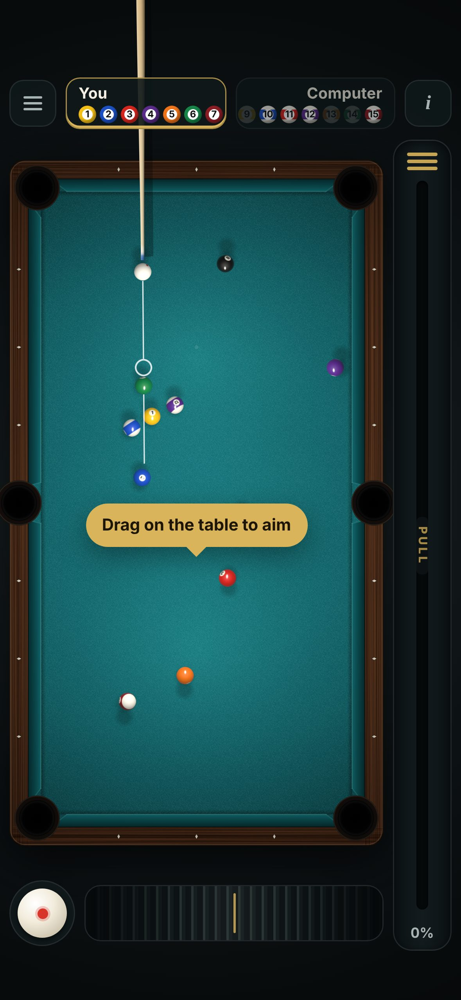

# Baize

8-ball pool for iPhone, built as a home-screen web app.

- Play pass-and-play on one phone, or against the computer at three levels. There's also a free practice table.
- Physics are deterministic, rules are WPA-based, and it works offline.
- No accounts, ads, coins or servers.



## Before you deploy: two GitHub things to check

1. **The live URL is probably `https://strikeadeal.github.io/Pool/`, not `/pool/`.** The repository is named `Pool` with a capital P, and GitHub Pages paths are case-sensitive.
   - The game uses only relative paths, so it works at either URL.
   - The URL matters because Add to Home Screen ties the installed app (and its saved games) to the exact URL it was installed from.
   - If you want `/pool/`, rename the repository to `pool` (Settings → General → Repository name) **before** installing on your phone.
2. **The repository has no `main` branch yet.** All the work is on `claude/iphone-pool-game-aiver9`. Make it `main` by doing one of the following:
   - In GitHub, go to Branches, rename `claude/iphone-pool-game-aiver9` to `main`, and set it as the default branch.
   - Or run `git push origin claude/iphone-pool-game-aiver9:main` and set `main` as the default branch.

## One-time GitHub setup

1. Settings → Pages → Build and deployment → **Source: GitHub Actions**.
2. That's all. Every push to `main` runs the tests, builds and deploys.
   - If you created `main` by renaming a branch, no push event fires. Start the first deploy from Actions → **Test and deploy** → **Run workflow**.

## Install it on your iPhone

1. Open the site in **Safari**.
2. Tap the Share button, then **Add to Home Screen**, then **Add**.
3. Launch Baize from its icon. It runs full-screen.
4. Open it once while online. After that it works in Airplane Mode.

**Updates:**
- After you push, the installed app downloads the new version in the background the next time it's opened.
- It switches over at a safe moment: straight after launch, on the menu, or at the end of a game. It never switches in the middle of a game.
- A small "Updated" note confirms it.
- There's no need to delete and re-add the app.

**Saved games:**
- The game saves after every shot and the moment a shot is taken, so it survives a call, locking the phone, or iOS closing the app mid-shot.
- Safari tabs and the installed app keep **separate** saved games and stats (an iOS rule, not something an app can change).

## How to play

| | |
|---|---|
| **Aim** | Drag anywhere on the table; the cue turns with your finger. Tap a spot to point straight at it. |
| **Fine-tune** | Slide the ribbed roller under the table (beside it in landscape) for small adjustments. |
| **Shoot** | Pull the power bar down and let go. Slide back to the top to cancel. |
| **Spin** | Tap the little cue ball to set where the cue hits: above for follow, below for draw, sides for english. |
| **Ball in hand** | Drag the cue ball (it has a ring around it) to place it. |
| **Calling the 8** | The game suggests a pocket (gold ring); tap another pocket to change it. |
| **Watching** | Tap during a shot to fast-forward. |

Rules (WPA 8-ball, details and deviations in [DECISIONS.md](DECISIONS.md#2-rules)):

- **The break:** break from behind the line. Pot a ball, or send four to a cushion, or it's an illegal break.
- **Groups:** the table is open after the break. The first ball you pot legally makes that group (solids or stripes) yours.
- **A legal shot:** hit your own group first, then pot a ball or make any ball touch a cushion. Potting one of yours keeps you at the table.
- **Fouls:** a foul gives your opponent ball in hand anywhere.
- **The 8:** clear your group, then pot the 8 in the called pocket. Potting it early, in the wrong pocket, or on a foul loses.

**Settings:**
- Sound and haptics on or off.
- Aim guide: Minimal, Standard or Long.
- Left-handed controls.
- Reduce motion.
- Instant shots.
- Assisted aiming: pick a ball and pocket from a list, with buttons instead of dragging.

## Run it locally

Needs Node 20 or later. There are no dependencies to install.

```sh
npm test          # 40 tests: physics, rules, storage, complete computer-vs-computer games
npm start         # builds to dist/ and serves it at http://localhost:8080/pool/ (like GitHub Pages)
```

- **Testing on your phone:** run `npm start`, then open `http://<your-computer's-LAN-IP>:8080/pool/` on the phone, on the same Wi-Fi.
  - Service workers need HTTPS on anything except localhost, so offline mode and updates only work on the deployed site.
- **Browser tests** (optional; needs Playwright, `npm i -D playwright && npx playwright install chromium webkit`):

  ```sh
  node tools/e2e/verify.cjs chromium --shots   # 24 checks; screenshots into docs/screenshots
  node tools/e2e/verify.cjs webkit             # the same checks in WebKit
  ```

- **Icons and launch images:** to regenerate them from `src/icons/icon.svg`, run `node tools/icons.mjs` (also needs Playwright).

## How it's built

| Path | What it is |
|---|---|
| `src/` | The whole app, served as-is: `index.html`, `css/`, `js/` (ES modules, no framework), icons, `manifest.webmanifest`, `sw.js` |
| `src/js/physics.js` | Deterministic simulation: exact contact times, soft-contact break, cushions and real pocket geometry |
| `src/js/rules.js` | 8-ball rules as pure functions |
| `src/js/ai.js` | Computer opponent |
| `src/js/render.js` | WebGL renderer (balls are shaded per pixel, with rolling number decals) |
| `src/js/feel.js` | **Every control feel value, in one commented file** |
| `src/js/main.js` | Screens, turns, playback, saving, updates |
| `tools/build.mjs` | Copies `src/` to `dist/` and stamps a version derived from the content into the app and the service worker's precache list (SHA-256, with SRI) |
| `.github/workflows/deploy.yml` | Test → build → deploy to Pages on push to `main`; tests only on pull requests |

**Diagnostics:** in Settings, long-press the version label for 2 seconds. It shows the measured viewport and safe areas, has a frame-rate meter and a viewport override, and has the **touch recorder**. Switch on "Record touches", play a few shots, then tap Share… to send the JSON.

## Documents

- [DECISIONS.md](DECISIONS.md): every significant decision, the alternatives and why, plus which feel values to adjust first.
- [VERIFICATION.md](VERIFICATION.md): what was checked and where, and what still needs a real iPhone.

## What I'd build next

1. **Tuning from your touch recordings.** That's what the recorder is for. The first things to revisit are fine-aim gain and power travel.
2. **A replay of the last shot** from any angle. The sim already records every frame, so this is mostly UI.
3. **A "pro" mode and deeper stats:** no guide past first contact, and pot percentage by distance and cut angle.
4. **Ball-ball throw and cue-ball squirt**, as an optional "advanced physics" setting.
5. **9-ball**, which reuses the physics, renderer and most of the rules plumbing.

## Deliberately left out

- **Online play, accounts, leaderboards:** each needs a server, and the brief rules one out.
- **Coins, shops, unlocks, cue collections, ads:** the brief rules them out, and they'd be noise in a small game.
- **Jump and massé shots** (the cue is always level). They're rare in 8-ball, and they're hard to control on a phone.
- **Throw and squirt** (see above). Leaving them out keeps the guide line truthful.
- **Calling every ball.** Only the 8 is called, the mobile convention.
- **Trick shots, a 3D camera, a music soundtrack.**
